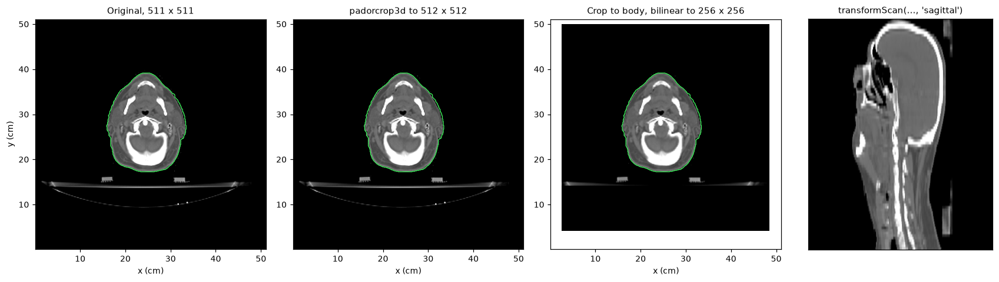
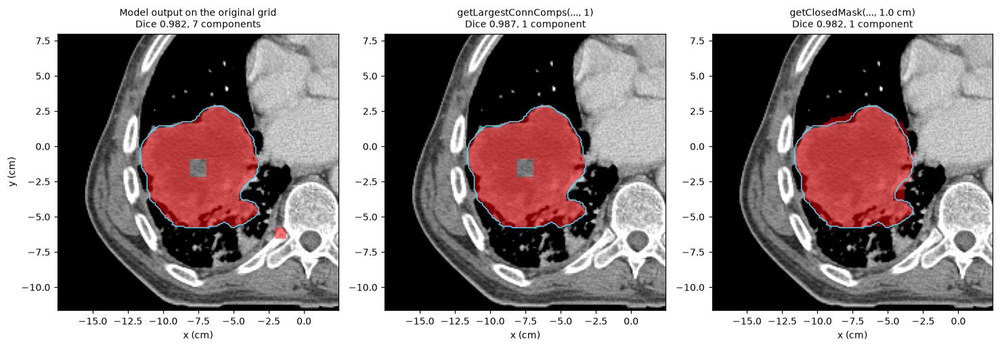

AI model inference
==================

pyCERR runs pretrained deep-learning segmentation models on scans in a
``planC`` and brings the results back as structures. It does the parts of an
AI pipeline that depend on the imaging data rather than the network: reading
DICOM or NIfTI, preparing the input the model was trained on, mapping the
output back onto the original scan, cleaning it up and exporting it.

There are two ways to use it:

* **Models from the CERR model library**, through ``cerr.ai_models``.
  Each model is installed with its weights and its own Python environment,
  and a run specification tells pyCERR how to prepare inputs, call the model
  and import outputs.
* **Your own model.** The same pre- and post-processing tools work around any
  network you can call from Python or the command line.

This page covers both, then the pre- and post-processing options in detail.

.. note::

   The model-library commands on this page were not executed when the page
   was built, because they download model weights. The pre- and
   post-processing figures were computed from bundled data.

Models from the CERR model library
----------------------------------

Install the model manager
~~~~~~~~~~~~~~~~~~~~~~~~~

The installer is distributed from GitHub, not PyPI. It needs ``git`` and
``curl``, and on Windows Git Bash.

.. code-block:: bash

   pip install "model_installer @ git+https://github.com/cerr/model_installer.git"

List, install and inspect
~~~~~~~~~~~~~~~~~~~~~~~~~

.. code-block:: python

   from cerr import ai_models
   from cerr.ai_models import install_utils, run_utils

   models = install_utils.listModels()        # prints and returns {number: name}

   modelNum = 1
   installDir = '/path/to/models'
   ai_models.install(modelNum, installDir)    # weights + an isolated environment

   run_utils.listInputs(modelNum, installDir) # inputs this model expects

Each model is installed to ``<installDir>/<model name>`` with its own
``.venv``, so its dependencies (PyTorch, model code) never touch the
environment pyCERR runs in. Some models are in private repositories; pass
``credentials='user:token'`` to :func:`ai_models.install
<cerr.ai_models.install_utils.main>` for those.

Run
~~~

.. code-block:: python

   userInputs = {'input_path': '/data/pt1/dicom',     # DICOM directory or NIfTI file
                 'output_path': '/data/pt1/ai_output',
                 'session_path': '/data/pt1/session'} # scratch space
   ai_models.run(modelNum, installDir, userInputs, verbose=True)

:func:`ai_models.run <cerr.ai_models.run_utils.main>` performs four steps:

1. **Pre-process.** Loads the input into a ``planC``, transforms the scan as
   the model requires and writes it to ``<session_path>/input``.
2. **Infer.** Calls the model's entry point in its own environment.
3. **Post-process.** Imports the model output onto the processed scan, maps
   it back to the original scan, cleans it up and exports it.
4. **Export.** To ``output_path``: a DICOM RTSTRUCT for DICOM input, a NIfTI
   label map for NIfTI input.

Additional keys in ``userInputs`` are passed to the model, for example
``'gpu': 0``. ``listInputs`` shows which a model accepts.

To import a model's outputs into a ``planC`` you already hold:

.. code-block:: python

   planC = run_utils.importSeg(modelNum, installDir, '/data/pt1/ai_output', scanNum, planC)

The run specification
~~~~~~~~~~~~~~~~~~~~~

Each installed model has a ``run_spec.yaml`` that drives the steps above. Its
structure, with illustrative values:

.. code-block:: yaml

   preprocessing:
     script: CT_LungOAR_incrMRRN.py      # in cerr/ai_models/prep, or the model dir
     mode: in_process                    # or: subprocess
   execution:
     entrypoint: model_wrapper/run_inference.py
     arguments:
       - {name: input_path,  type: positional, required: true}
       - {name: output_path, type: positional, required: true}
       - {name: gpu, type: flag, flag_string: --gpu, default: 0, required: false}
   postprocessing:
     script: CT_LungOAR_incrMRRN.py      # in cerr/ai_models/post
   outputs:
     "*_AI_seg.nii.gz": {Lung_Left: 1, Lung_Right: 2, Heart: 3}

.. list-table::
   :header-rows: 1
   :widths: 30 70

   * - Field
     - Meaning
   * - ``preprocessing.mode``
     - ``in_process``: a Python module in ``cerr/ai_models/prep`` runs inside
       pyCERR. ``subprocess``: a script in the model directory runs in the
       model's environment as ``script --image <nii> --out_dir <dir> --gpu <n>``,
       for steps that need the model's libraries (such as skull stripping).
   * - ``execution.entrypoint``
     - The model's inference script, relative to the model directory.
   * - ``execution.arguments``
     - How each ``userInputs`` entry becomes a command-line argument:
       ``positional`` (value only), ``flag`` (``flag_string value``) or
       ``boolean_flag`` (``flag_string`` when true).
   * - ``postprocessing.script``
     - A Python module in ``cerr/ai_models/post``.
   * - ``outputs``
     - For :func:`~cerr.ai_models.run_utils.importSeg`: a file pattern and the
       structure name for each label.

Adding pre- and post-processing for a model
~~~~~~~~~~~~~~~~~~~~~~~~~~~~~~~~~~~~~~~~~~~

An in-process pre-processing module defines ``REQUIRED_INPUTS`` and
``processInputData``:

.. code-block:: python

   REQUIRED_INPUTS = {'input_path': {'required': True},
                      'output_path': {'required': True},
                      'session_path': {'required': True}}

   def processInputData(userInputs):
       """Load the input, prepare the scan, write the model input to
       <session_path>/input. userInputs also contains 'model_dir'."""
       ...
       return planC, procScanNum, scanNum, sessionUserInputs

``scanNum`` is the original scan, ``procScanNum`` the prepared one, and
``sessionUserInputs`` the inputs passed on to the model (typically with
``input_path`` and ``output_path`` pointing into the session directory).

A post-processing module defines ``postProcAndImportSeg``:

.. code-block:: python

   def postProcAndImportSeg(planC, procScanNum, scanNum, userInputs, outDir):
       """Import the model output from outDir, map it to scanNum, clean it up
       and export it to userInputs['output_path']."""
       ...
       return planC

``cerr/ai_models/prep/CT_LungOAR_incrMRRN.py`` and
``cerr/ai_models/post/CT_LungOAR_incrMRRN.py`` are complete, short examples.

Running your own model
----------------------

Any model that reads NIfTI and writes a label map fits this pattern:

.. code-block:: python

   import subprocess
   from cerr import plan_container as pc
   from cerr.utils import image_proc
   from cerr.dataclasses import structure as cerrStr

   planC = pc.loadDcmDir('/data/pt1/dicom')
   scanNum = 0
   scan3M = planC.scan[scanNum].getScanArray()
   gridS = planC.scan[scanNum].getScanXYZVals()

   # 1. Prepare the input and keep it in planC with its grid
   net3M, _, netGridS = image_proc.resizeScanAndMask(scan3M, None, gridS,
                                                     [512, 512, scan3M.shape[2]],
                                                     'padorcrop3d')
   planC = pc.importScanArray(net3M, *netGridS, 'CT', scanNum, planC)
   procScanNum = len(planC.scan) - 1
   planC.scan[procScanNum].saveNii('/tmp/session/input/scan.nii.gz')

   # 2. Run the model
   subprocess.run(['python', 'predict.py', '/tmp/session/input', '/tmp/session/output'],
                  check=True)

   # 3. Import the output on the prepared scan, then map it to the original
   labels = {'Heart': 1, 'Esophagus': 2}
   n0 = len(planC.structure)
   planC = pc.loadNiiStructure('/tmp/session/output/scan.nii.gz', procScanNum, planC, labels)
   for structNum in range(n0, len(planC.structure)):
       planC = cerrStr.copyToScan(structNum, scanNum, planC)

:func:`cerr.utils.ai_pipeline.createSessionDir` creates uniquely named
session input and output folders for batch runs, and
:func:`cerr.utils.ai_pipeline.getScanNumFromIdentifier` picks the right scan
from a study by modality, series description or date:

.. code-block:: python

   from cerr.utils.ai_pipeline import getScanNumFromIdentifier
   scanNum = getScanNumFromIdentifier({'imageType': 'CT SCAN'}, planC)[0]

Pre-processing options
----------------------

A network expects a fixed matrix size, often a particular field of view,
orientation and intensity range. The tools below produce that input **and a
coordinate grid for it**, so the prepared scan can be imported into ``planC``
and lines up with the original. That is what lets the model output be mapped
back.

   The head and neck CT prepared three ways, each drawn in its own grid with
   the body outline of the original scan (green). The outline lines up in
   every panel. Right: the prepared scan rearranged into sagittal slices.

Resize
~~~~~~

:func:`~cerr.utils.image_proc.resizeScanAndMask` changes the matrix size:

.. code-block:: python

   from cerr.utils import image_proc

   out3M, outMask4M, outGridS = image_proc.resizeScanAndMask(
       scan3M, mask4M, gridS, [nRows, nCols, nSlices], method)

``mask4M`` is optional (pass ``None``) and holds one binary mask per
structure along the fourth axis. ``gridS`` is ``getScanXYZVals()`` of the
scan.

.. list-table::
   :header-rows: 1
   :widths: 24 76

   * - ``method``
     - Result
   * - ``padorcrop3d``
     - Pads or crops rows and columns symmetrically to the output size, each
       axis independently; voxel size is unchanged. Padding uses the scan
       minimum. The usual choice when the network takes, say, 512 × 512.
   * - ``pad3d``, ``unpad3d``
     - The same, but only padding or only cropping. ``unpad3d`` undoes
       ``pad3d``.
   * - ``bilinear``, ``bicubic``, ``nearest``
     - Interpolates each slice to the output rows and columns, changing the
       voxel size. Masks are always resized with ``nearest``.
   * - ``pad2d``, ``unpad2d``
     - Cuts a fixed-size window centred on a per-slice bounding box
       (``limitsM``), and the inverse.
   * - ``padslices``, ``unpadslices``
     - Adds or removes slices at the end.

With ``preserveAspectFlag=True``, ``padorcrop3d`` and the interpolating
methods first pad the image to a square with the background intensity, so
anatomy is not stretched.

.. code-block:: python

   # crop to the body, then resize to the network input without distortion
   from cerr.utils import mask as maskUtils

   body3M = maskUtils.getPatientOutline(scan3M)
   rMin, rMax, cMin, cMax, sMin, sMax, _ = maskUtils.computeBoundingBox(body3M, maskFlag=5)
   crop3M = scan3M[rMin:rMax + 1, cMin:cMax + 1, sMin:sMax + 1]
   cropGridS = (gridS[0][cMin:cMax + 1], gridS[1][rMin:rMax + 1], gridS[2][sMin:sMax + 1])
   net3M, _, netGridS = image_proc.resizeScanAndMask(crop3M, None, cropGridS,
                                                     [256, 256, crop3M.shape[2]],
                                                     'bilinear', preserveAspectFlag=True)

:func:`~cerr.utils.mask.computeBoundingBox` returns inclusive limits, hence
the ``+ 1``; ``maskFlag`` adds a margin in voxels. Note the grid slicing:
``xV`` runs along columns and ``yV`` along rows.

Other preparation
~~~~~~~~~~~~~~~~~

.. list-table::
   :header-rows: 1
   :widths: 40 60

   * - Need
     - Tool
   * - Field of view: crop to the body or to an organ
     - :func:`cerr.utils.mask.getPatientOutline` (:doc:`body_outline`),
       :func:`cerr.utils.mask.computeBoundingBox`
   * - Orientation: feed sagittal or coronal slices to a 2D network
     - :func:`cerr.utils.image_proc.transformScan` with ``'sagittal'`` or
       ``'coronal'``; it transposes the scan, masks and grid together.
   * - Voxel size: resample to a fixed spacing
     - :func:`cerr.radiomics.preprocess.imgResample3D` with
       :func:`cerr.radiomics.preprocess.getResampledGrid`
   * - Intensity: clip and normalise
     - NumPy on the scan array, for example ``np.clip(scan3M, -1000, 1000)``;
       :func:`cerr.radiomics.preprocess.calcRobustZscore` for MR
   * - Several inputs: fixed and moving scans, or multi-parametric MR
     - :doc:`registration` to bring them onto one grid first
   * - Choose the scan from a study
     - :func:`cerr.utils.ai_pipeline.getScanNumFromIdentifier`

Post-processing options
-----------------------

A raw network output usually needs three things: mapping back onto the
original scan, removing stray voxels, and closing small gaps.

   A stand-in model output for the phantom GTV, produced on a 128 × 128
   version of the scan with eight false-positive islands and a hole, then
   copied to the original 201 × 204 grid (left). Keeping the largest connected
   component removes the islands (centre); closing fills the hole (right).
   The reference GTV is outlined in cyan.

.. code-block:: python

   from cerr.dataclasses import structure as cerrStr

   # Model output on the prepared scan -> structure on the original scan
   planC = pc.importStructureMask(pred3M, procScanNum, 'AI_GTV', planC)
   planC = cerrStr.copyToScan(len(planC.structure) - 1, scanNum, planC)
   aiNum = len(planC.structure) - 1

   # Keep the largest connected component, then close gaps up to 1 cm
   _, planC = cerrStr.getLargestConnComps(aiNum, 1, planC=planC, saveFlag=True,
                                          procSructName='AI_GTV_largest')
   _, planC = cerrStr.getClosedMask(len(planC.structure) - 1, 1.0, planC, saveFlag=True,
                                    procSructName='AI_GTV_final')

.. code-block:: text

   AI_GTV           Dice vs GTV 0.982  components 7
   AI_GTV_largest   Dice vs GTV 0.987  components 1
   AI_GTV_final     Dice vs GTV 0.982  components 1

Closing fills the hole but also the concave notches along the edge, so it can
lower Dice against a contour that follows those notches. Choose the element
size to match the gaps you expect.

.. list-table::
   :header-rows: 1
   :widths: 40 60

   * - Step
     - Tool
   * - Map to the original scan
     - :func:`cerr.dataclasses.structure.copyToScan`, or
       :func:`~cerr.utils.image_proc.resizeScanAndMask` with the inverse method
       on the mask array
   * - Remove islands
     - :func:`cerr.dataclasses.structure.getLargestConnComps`
       (``numConnComponents=2`` for paired organs)
   * - Fill holes and gaps
     - :func:`cerr.dataclasses.structure.getClosedMask`
   * - Smooth jagged edges
     - :func:`~cerr.dataclasses.structure.getGaussianBlurredMask`,
       :func:`~cerr.dataclasses.structure.getBsplineSmoothing`; see
       :doc:`smoothing`
   * - Clip to the body or another structure
     - :func:`~cerr.dataclasses.structure.structIntersect`
   * - Combine several models
     - :doc:`structure_consensus`
   * - Score against a reference
     - :doc:`segmentation_metrics`
   * - Export
     - :func:`cerr.dcm_export.rtstruct_iod.create`,
       :func:`cerr.plan_container.saveNiiStructure`

See also
--------

* Model library and installer: https://github.com/cerr/model_installer
* Notebooks: ``03_autosegmentation`` in https://github.com/cerr/pyCERR-Notebooks.
* API reference: :doc:`../cerr.ai_models`, :doc:`../cerr.utils`.
* Figure script: ``docs/_figure_scripts/ai_pipeline.py``.
