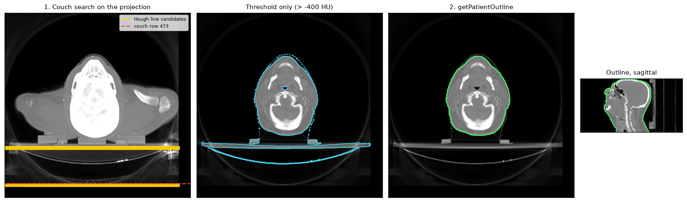

Patient outline and couch removal
=================================

Many workflows need a mask of the patient: to restrict registration or
radiomics to the body, to crop a scan before AI inference, or to provide the
external contour for dose calculation. A plain intensity threshold does not
give one, because the treatment couch, head rest and immobilisation devices
are as dense as soft tissue and touch the patient.

:func:`cerr.utils.mask.getPatientOutline` separates the patient from those
objects. It has been tested on head and neck, lung and prostate CT and on MR
(Iyer et al.).

Prerequisites
-------------

A scan. The examples use the bundled head and neck CT, which includes the
couch and a head rest:

.. code-block:: python

   from cerr import datasets
   from cerr import plan_container as pc

   planC = pc.loadDcmDir(datasets.fetch_sample_data('head_and_neck'))

Minimal example
---------------

.. code-block:: python

   from cerr.utils import mask as maskUtils

   scanNum = 0
   scan3M = planC.scan[scanNum].getScanArray()
   outline3M = maskUtils.getPatientOutline(scan3M, outThreshold=-400)
   planC = pc.importStructureMask(outline3M, scanNum, 'Body', planC)

How it works
------------

1. **Find the couch.** :func:`~cerr.utils.mask.getCouchLocationHough` takes
   the maximum-intensity projection through the slices, detects edges and
   searches it for long horizontal lines with a Hough transform. Candidate
   lines must lie in the lower half of the image and overlap its central
   columns. Rows from the selected line down are excluded.
2. **Threshold.** Voxels brighter than the 5th percentile of the voxels
   above ``outThreshold`` are kept.
3. **Separate and clean, slice by slice.** A morphological opening detaches
   the patient from whatever still touches it (head rests, the couch top);
   the largest connected region is kept, holes are filled, small islands
   removed and the edge smoothed.
4. **Keep one object in 3D.** The largest 3D connected component is
   returned.

   1: Hough line candidates on the projection and the row selected as the
   couch. Centre left: a threshold at -400 HU includes the couch and the head
   rest. Centre right: the outline from ``getPatientOutline``. Right: the
   outline on a sagittal slice.

On this scan the threshold alone gives 2.86 million voxels and the outline
2.34 million (7.0 litres). In this example the selected couch row is the
lower edge of the couch near the bottom of the image; the couch top and head
rest are removed in step 3. The line search is randomised, with a fixed seed
by default so the result is reproducible.

Parameters
----------

.. list-table::
   :header-rows: 1
   :widths: 22 78

   * - Argument
     - Effect
   * - ``outThreshold``
     - Intensity of air. -400 HU suits CT. For MR, set ``normFlag=True`` and
       give a threshold on the normalised intensity, such as 0.01.
   * - ``normFlag``
     - Divide the scan by its maximum before thresholding. Recommended for MR.
   * - ``slicesV``
     - Slice indices to process; the default is all.
   * - ``minMaskSize``
     - Smallest patient cross-section, in voxels, that a slice may have
       (default 1500). Slices with only smaller objects are left empty.

MR example:

.. code-block:: python

   outline3M = maskUtils.getPatientOutline(mrScan3M, outThreshold=0.01, normFlag=True)

To inspect or reuse the couch position:

.. code-block:: python

   couchRow, lines = maskUtils.getCouchLocationHough(scan3M)
   # lines: list of {'point1': (col, row), 'point2': (col, row)}

``seed`` (default 0) seeds the randomised line search; pass ``seed=None`` for
a different draw on each call.

``getCouchLocationHough`` assumes a horizontal couch at the bottom of the
image, as in supine scans. If none is found it returns the number of rows,
so nothing is excluded.

Using the outline
-----------------

* **Registration**: pass the outlines of the fixed and moving scans as
  ``baseMask3M`` and ``movMask3M`` (:doc:`registration`).
* **AI pre-processing**: crop to the outline's bounding box before resizing
  (:doc:`ai_inference`).
* **Clean-up**: combine with other structures using the operations in
  :doc:`segmentation`, for example ``structIntersect`` to clip an
  auto-segmentation to the body.

See also
--------

* Notebook: ``03_autosegmentation/autosegment_patient_outline.ipynb`` in
  https://github.com/cerr/pyCERR-Notebooks.
* API reference: :doc:`../cerr.utils`.
* Figure script: ``docs/_figure_scripts/body_outline.py``.
