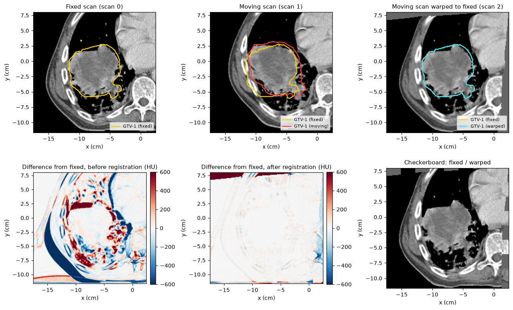

Image registration
==================

The :mod:`cerr.registration` package aligns one scan to another and carries
structures and dose across with the resulting transformation. Registration is
done with `ANTs <https://github.com/ANTsX/ANTsPy>`_, and the result is stored
in ``planC.deform`` so that later steps can reuse it.

Typical uses are propagating contours from a planning scan to a follow-up
scan, mapping dose between scans for accumulation, and aligning multi-modal
studies of one patient.

Terms
-----

* The **fixed** (or base) scan stays put. Results are produced on its grid.
* The **moving** scan is warped to match it.
* A **deform object** (:class:`~cerr.dataclasses.deform.Deform`) records the
  two scans by UID, the tool and algorithm, and where the transformation is
  stored.

Prerequisites
-------------

ANTs is an optional extra:

.. code-block:: bash

   pip install "pycerr[ants]"

The functions in :mod:`cerr.registration.register` (``registerScans``,
``warpScan``, ``warpStructures``, ``warpDose``, ``calcVectorField``,
``calcJacobian``) use ANTs. :mod:`cerr.registration.ants_reg` has the
underlying ANTs functions, with more options: transform presets, masks,
landmarks and extra ``ants.registration`` arguments. Its functions are also
importable from :mod:`cerr.registration.register`.

The two scans can sit in the same ``planC`` or in two different ones. The
examples below use a single ``planC`` in which scan 0 is fixed and
scan 1 is moving. Because the bundled data has only one scan per patient, the
moving scan was made by warping the lung phantom with a known shift and a
smooth deformation; ``docs/_figure_scripts/registration.py`` has the code.

Minimal example
---------------

.. code-block:: python

   from cerr.registration import register

   baseScanNum, movScanNum = 0, 1
   planC = register.registerScans(planC, baseScanNum, planC, movScanNum,
                                  '/path/to/transforms')

   warpedScanNum = len(planC.scan) - 1      # moving scan resampled on the fixed grid
   deformS = planC.deform[-1]               # the transformation

Walkthrough
-----------

Register
~~~~~~~~

.. code-block:: python

   planC = register.registerScans(planC, baseScanNum, planC, movScanNum,
                                  '/path/to/transforms', deforAlgorithm='bsplines')

   deformS = planC.deform[-1]
   print(len(planC.scan), len(planC.deform))
   print(deformS.registrationTool, deformS.algorithm)

.. code-block:: text

   3 1
   ants antsRegistrationSyNQuick[s]

The call appends two things to the fixed ``planC``: the warped moving scan
and a deform object. ``deforAlgorithm`` chooses the transform:

.. list-table::
   :header-rows: 1
   :widths: 30 70

   * - ``deforAlgorithm``
     - ANTs transform
   * - ``'rigid'``
     - ``Rigid``: rotation and translation.
   * - ``'affine'``
     - ``Affine``: adds scaling and shear.
   * - ``'bsplines'`` (default), ``'deformable'``
     - ``antsRegistrationSyNQuick[s]``: rigid, affine and deformable (SyN)
       stages in turn.
   * - any other value
     - Passed to ``ants.registration`` as the preset, e.g. ``'SyN'`` or
       ``'antsRegistrationSyN[s]'`` (slower, more thorough).

The transform files are written to the directory you pass. Keep it: the
deform object refers to the files by path. For options ``registerScans`` does
not expose (landmarks, extra ``ants.registration`` arguments), call
:func:`~cerr.registration.ants_reg.registerScansAnts` directly.

Warp structures and dose
~~~~~~~~~~~~~~~~~~~~~~~~

Once a deform object exists, apply it to anything defined on the moving
scan:

.. code-block:: python

   movStructNum = 1
   planC = register.warpStructures(planC, baseScanNum, planC, [movStructNum], deformS)
   warpedStructNum = len(planC.structure) - 1

   planC = register.warpDose(planC, baseScanNum, planC, movDoseNum, deformS)
   planC = register.warpScan(planC, baseScanNum, planC, otherMovScanNum, deformS)

Each applies the transform with the tool that produced it: ANTs for ANTs
registrations and for vector fields stored in NIfTI files, the matrix for
rigid registrations imported from DICOM REG.

Warped objects are appended to the fixed ``planC`` and associated with the
fixed scan. A warped structure keeps the name of its source, so rename it if
both will be exported:

.. code-block:: python

   planC.structure[warpedStructNum].structureName = 'GTV-1 (warped)'

Check the result
~~~~~~~~~~~~~~~~

Always inspect a registration before using it. Overlay the warped scan on
the fixed scan, and where the same structure exists on both, compare the
warped contour with the reference one:

.. code-block:: python

   from cerr.contour import rasterseg as rs

   fixedMask3M = rs.getStrMask(0, planC)
   warpedMask3M = rs.getStrMask(warpedStructNum, planC)
   dice = 2.0 * (fixedMask3M & warpedMask3M).sum() / (fixedMask3M.sum() + warpedMask3M.sum())

For the example this gives a Dice coefficient of 0.997, up from 0.795 before
registration, and the root-mean-square intensity difference inside the body
falls from 330 HU to 72 HU. ANTs registration is not bit-for-bit
reproducible, so the last digit can vary between runs.

   Top: fixed scan, moving scan and the moving scan after registration, with
   the fixed GTV in yellow. Bottom: intensity difference from the fixed scan
   before and after registration, and a checkerboard of fixed and warped
   scans, in which anatomy should continue smoothly across tile borders.

The desktop viewer has a registration QA tool with mirror-scope,
side-by-side, checkerboard and toggle modes and a deformation-vector overlay.
Open it from the Tools menu or from a script:

.. code-block:: python

   from cerr.viewer.pycerr_gui import show

   v = show(planC)
   v.start_reg_qa(base=0, moving=warpedScanNum, mode='Mirrorscope')

:doc:`registration_qa` covers the QA modes, contour metrics, the displacement
field and the Jacobian in detail.

Options
-------

Masks
~~~~~

Restrict the similarity metric to a region, for example the body outline or
a lung mask, when anatomy outside it would mislead the optimizer (couch,
immobilization devices, a different field of view):

.. code-block:: python

   planC = register.registerScans(planC, 0, planC, 1, '/path/to/transforms',
                                  baseMask3M=fixedBodyMask3M,
                                  movMask3M=movingBodyMask3M)

Masks are boolean arrays on the grid of the respective scan.
:func:`cerr.utils.mask.getPatientOutline` produces a body mask from a CT.

Landmarks
~~~~~~~~~

Paired landmarks give the registration a starting alignment when the scans
are far apart. This option is in
:func:`~cerr.registration.ants_reg.registerScansAnts`:

.. code-block:: python

   planC = register.registerScansAnts(
       planC, 0, planC, 1,
       baseLandmarksM=fixedPointsM,          # N x 3
       movLandmarksM=movingPointsM,          # N x 3, same order
       landmarkCoordSys='cerr',              # pyCERR virtual x, y, z in cm
       landmarkTransformType='rigid')

Use ``landmarkCoordSys='dicom'`` for points in DICOM patient coordinates
(LPS, mm).

Vector field and Jacobian
-------------------------

An ANTs registration is stored as a transform chain. To get the displacement
of every voxel, and the Jacobian determinant (local volume change: below 1
contraction, above 1 expansion, at or below 0 folding):

.. code-block:: python

   planC = register.calcVectorField(deformS, planC, baseScanNum, '/path/to/transforms')
   dvfDeform = planC.deform[-1]                        # 'vf' deform object
   planC = register.calcJacobian(deformS, planC)       # added as a scan

:doc:`registration_qa` shows how to use both.

plastimatch (deprecated)
------------------------

Earlier versions registered with plastimatch. It still works with
``registrationTool='plastimatch'`` in :func:`~cerr.registration.register.registerScans`
(and ``tool='plastimatch'`` in ``calcJacobian``), if plastimatch is installed
and on the ``PATH``, but it issues a ``FutureWarning`` and will be removed in a
future release. Deform objects from earlier plastimatch registrations are
still warped with plastimatch.

Importing existing registrations
--------------------------------

.. list-table::
   :header-rows: 1
   :widths: 38 62

   * - Source
     - Function
   * - DICOM Spatial Registration or Deformable Spatial Registration (REG)
     - :func:`~cerr.plan_container.loadDcmReg`. Apply a rigid result with
       :func:`~cerr.registration.register.warpScanRigid` and
       :func:`~cerr.registration.register.warpStructuresRigid`.
   * - Vector field in NIfTI
     - :func:`~cerr.plan_container.loadNiiVf`

To read displacement vectors back for analysis or plotting,
:func:`~cerr.registration.register.getDvfGrid` samples a field on a regular
grid in virtual coordinates and
:func:`~cerr.registration.register.getDvfVectors` returns them as a point
list, optionally restricted to a structure or its surface. Both need a deform
object that carries a sampled field
(:func:`~cerr.dataclasses.deform.hasDvfMatrix`): sample a registration with
:func:`~cerr.registration.register.calcVectorField` first. See
:doc:`registration_qa`.

See also
--------

* :doc:`planc` for how deform objects reference scans.
* Tests with further usage: ``tests/test_registration_default_ants.py``,
  ``tests/test_ants_registration.py``, ``tests/test_dcm_reg_import.py``.
* API reference: :doc:`../cerr.registration`.
