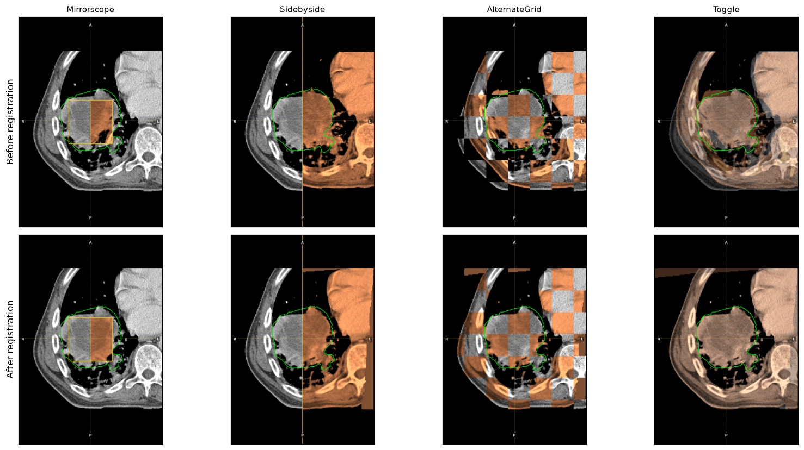
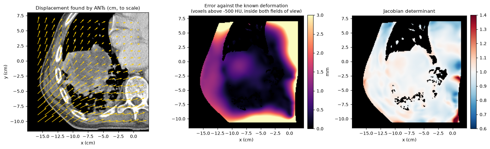

Registration quality assurance
==============================

A registration can look plausible and still be wrong by several millimetres
in the region that matters. AAPM Task Group 132 recommends checking every
clinical registration, visually and with numbers, and TG-211 lists metrics
for comparing contours in longitudinal imaging. This page shows how to do
both with pyCERR.

Prerequisites
-------------

A ``planC`` with a fixed scan, a moving scan, and a registration between them
(see :doc:`registration`). The examples continue the registration page: the
moving scan is the lung phantom deformed by a **known** shift and smooth
warp, registered back with ANTs. Because the true deformation is known, the
registration error can be measured directly, which is not possible with
patient data.

Visual checks in the viewer
---------------------------

The desktop viewer (``pycerr[viewer]``) has a registration QA tool under
*Tools > Registration QA*. It shows the fixed and moving scans together in
four ways:

.. list-table::
   :header-rows: 1
   :widths: 20 80

   * - Mode
     - Display
   * - ``Mirrorscope``
     - A box in which the moving scan is mirrored about the centre line, so
       edges should continue straight across it. Drag the box over the region
       of interest.
   * - ``Sidebyside``
     - Fixed scan on one side of a movable line, moving scan on the other.
   * - ``AlternateGrid``
     - A checkerboard of the two scans. Look for steps at tile borders.
   * - ``Toggle``
     - A blend of the two, adjustable from all-fixed to all-moving. Flicking
       between them shows any residual motion.

All four can be scripted, for example to save screenshots for a QA record:

.. code-block:: python

   from cerr.viewer.pycerr_gui import show

   v = show(planC)
   v.start_reg_qa(base=0, moving=warpedScanNum, mode='AlternateGrid', size=3.0)
   v.save_screenshot('qa_checkerboard.png', target='Axial')
   v.start_reg_qa(mode='Toggle', base_frac=0.5)
   v.stop_reg_qa()

``size`` is the mirror box or tile size in cm, and ``base_frac`` the weight of
the fixed scan in ``Toggle`` mode. The moving scan is drawn with its own
window and colormap; set them by selecting it with ``v.set_scan(n)`` and
calling ``v.set_window_level`` and ``v.set_scan_colormap``.

   The four modes, comparing the fixed scan (grey) with the moving scan
   before registration (top) and the warped scan after it (bottom, copper).
   The fixed GTV is outlined in green. Before registration, the rib edges
   and the tumour boundary break at the mirror line and tile borders; after
   it they continue.

For headless use (a batch QA job on a server), set
``QT_QPA_PLATFORM=offscreen`` before importing the viewer. 2D views render
offscreen; the 3D view needs an OpenGL context.

Contour-based metrics
---------------------

Contours drawn on both scans independently, or a contour on the fixed scan
and its warped counterpart, give a direct measure in the region that matters.
These are TG-211's level 1 (volume, centre of mass) and level 2 (overlap and
distance) metrics.

.. code-block:: python

   from cerr.contour import structure_metrics as sm
   from cerr.dataclasses import structure as cerrStr

   # Bring the moving GTV onto the fixed scan for the "before" comparison
   planC = cerrStr.copyToScan(movStructNum, 0, planC)
   movOnFixedNum = len(planC.structure) - 1

   for label, n in (('before', movOnFixedNum), ('after', warpedStructNum)):
       m = sm.compareStructurePair(0, n, planC)
       print(label, m['Dice'], m['HD95_mm'], m['MSD_mm'], m['VolumeRatio'], m['APL_mm'])

.. code-block:: text

   before Dice 0.795  HD95 10.92 mm  MSD 4.28 mm  volume ratio 1.014  APL 6724 mm
   after  Dice 0.997  HD95 0.00 mm  MSD 0.02 mm  volume ratio 1.003  APL 64 mm

:func:`~cerr.contour.structure_metrics.compareStructurePair` is described in
:doc:`segmentation_metrics`. It also returns the distance between the centres
of mass, TG-211's level 1 position check.

.. caution::

   High overlap of the structure that drove the registration says little
   about the rest of the anatomy. Check structures that were not used to
   drive it, and check points away from them.

The deformation itself
----------------------

Two quantities summarise a deformable registration everywhere, not just at
contours:

* the **displacement field**: where each fixed voxel was mapped to;
* the **Jacobian determinant** of that mapping: local volume change, with 1
  meaning none, below 1 contraction, above 1 expansion. Values at or below 0
  mean the mapping folds over itself, which is physically impossible.

A deformable registration's transform has to be sampled as a vector field
on the fixed scan's grid before it can be inspected.
:func:`~cerr.registration.register.calcVectorField` does this and adds a
deform object with the field to ``planC.deform``;
:func:`~cerr.registration.register.getDvfGrid` samples it, and
:func:`~cerr.registration.register.calcJacobian` adds the Jacobian determinant
as a scan:

.. code-block:: python

   from cerr.registration import register

   planC = register.calcVectorField(deformS, planC, baseScanNum, '/path/to/transforms')
   dvfDeform = planC.deform[-1]
   (dRow3M, dCol3M, dSlc3M), (xV, yV, zV), info = register.getDvfGrid(
       dvfDeform, planC, baseScanNum, outputResV=[0, 0, 0])

   planC = register.calcJacobian(deformS, planC)
   jac3M = planC.scan[-1].getScanArray()

The three arrays hold the displacement in cm along virtual y (rows), x
(columns) and z (slices) on the fixed scan's grid, at the native resolution
because of ``outputResV=[0, 0, 0]``. ``info['valid']`` marks where the field is
defined. Passing a registration's deform object to ``getDvfGrid`` directly
raises an error that says to sample it first.

The same vector-field deform object drives the viewer's arrow overlay:
``v.set_dvf_overlay(len(planC.deform) - 1, resolution=[0.5, 0.5, 0.5])``.

   Left: displacements found by ANTs, drawn to scale. Centre: distance
   between the mapping ANTs found and the known deformation, for voxels
   above -500 HU that map inside the moving scan. Right: Jacobian
   determinant on the same voxels.

For the example, the error against the known deformation has a median of
1.1 mm and a 95th percentile of 4.4 mm. It is smallest in the tumour and
soft tissue, where there is image contrast to register, and largest at the
edge of the field of view. The Jacobian lies between 0.52 and 2.07 with no
folding. ANTs registration is not bit-for-bit reproducible, so these numbers
vary slightly between runs.

With patient data the true deformation is unknown. The substitutes are
**landmarks** identified on both scans (target registration error, the
distance between a fixed landmark and its mapped moving counterpart), the
contour metrics above, and the visual checks.

A QA checklist
--------------

1. Visual: step through the region of interest in at least two modes and
   two orientations.
2. Contours: Dice, HD95 and centre-of-mass shift for structures that were
   not used to drive the registration.
3. Landmarks: target registration error, where landmarks can be identified.
4. Deformation: no Jacobian values at or below 0; volume changes that are
   anatomically plausible.
5. Record: save screenshots and the metric table with the registration.

See also
--------

* :doc:`registration` for running registrations.
* :doc:`segmentation_metrics` for the contour metrics.
* Notebook: ``04_registration/TG211_metrics.ipynb`` in
  https://github.com/cerr/pyCERR-Notebooks.
* Figure script: ``docs/_figure_scripts/registration_qa.py``.
