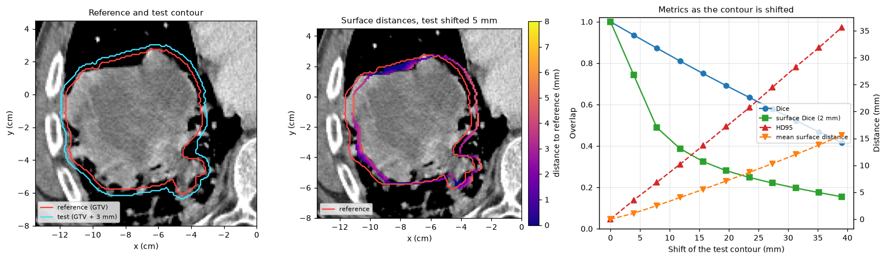

Segmentation metrics
====================

Comparing a contour with a reference is routine: scoring an auto-segmentation
against a manual one, checking how well a registration propagated a contour,
or measuring inter-observer variation. :mod:`cerr.contour.structure_metrics`
computes the usual metrics for two structures in a ``planC``, or for two
masks.

Three kinds of metric are in common use:

* **Overlap** metrics compare volumes: Dice, Jaccard, sensitivity, positive
  predictive value. They are insensitive to errors at the boundary of large
  structures.
* **Surface-distance** metrics compare boundaries: Hausdorff distance (HD),
  its 95th percentile (HD95), mean surface distance (MSD), and surface Dice,
  the fraction of the surface within a tolerance. These are computed with the
  ``surface_distance`` package installed with pyCERR.
* **Added path length** (APL) estimates editing effort: the length of
  reference contour that lies outside a tolerance band around the test
  contour, i.e. what someone would have to redraw.

Prerequisites
-------------

Two structures on the same scan. If they are on different scans, copy one
across first with :func:`~cerr.dataclasses.structure.copyToScan`. The
examples use the bundled lung phantom's GTV as the reference and modified
copies of it as test contours.

Minimal example
---------------

.. code-block:: python

   from cerr.contour import structure_metrics as sm

   m = sm.compareStructurePair(refStructNum, testStructNum, planC)
   print(m['Dice'], m['HD95_mm'], m['APL_mm'])

Structures can be given by index or by name, for example
``sm.compareStructurePair('Heart', 'AI_Heart', planC)``.

What is computed
----------------

:func:`~cerr.contour.structure_metrics.compareStructurePair` returns a
dictionary:

.. list-table::
   :header-rows: 1
   :widths: 28 72

   * - Key
     - Meaning
   * - ``Dice``, ``Jaccard``
     - Volume overlap, 0 to 1.
   * - ``Sensitivity``
     - Fraction of the reference covered by the test.
   * - ``PPV``
     - Fraction of the test that lies in the reference.
   * - ``HD_mm``, ``HD95_mm``
     - Largest, and 95th percentile, distance between the two surfaces.
   * - ``MSD_mm``
     - Mean surface distance, averaged over both directions.
   * - ``SurfaceDice_1mm``, ``_2mm``, ``_3mm``
     - Fraction of both surfaces within the tolerance of the other.
   * - ``RefVolume_cc``, ``TestVolume_cc``, ``VolumeRatio``
     - Volumes, and test / reference.
   * - ``CentroidDistance_mm``
     - Distance between the centres of mass.
   * - ``APL_mm``
     - Added path length with a 1 mm tolerance, summed over slices.

The tolerances, the Hausdorff percentile and the APL tolerance are arguments
(``surfaceTolerancesMm``, ``hdPercentile``, ``aplToleranceMm``). When either
structure is empty, overlap metrics are 0 and distance metrics NaN.

For the phantom GTV against three test contours:

.. list-table::
   :header-rows: 1
   :widths: 20 8 8 8 8 9 9 9 10 11

   * - Test contour
     - Dice
     - Jaccard
     - Sens.
     - PPV
     - HD95 (mm)
     - HD (mm)
     - MSD (mm)
     - Surf. Dice 2 mm
     - APL (mm)
   * - GTV + 3 mm
     - 0.893
     - 0.807
     - 1.000
     - 0.807
     - 3.16
     - 6.55
     - 2.06
     - 0.445
     - 7,388
   * - GTV − 3 mm
     - 0.789
     - 0.652
     - 0.652
     - 1.000
     - 7.16
     - 11.34
     - 4.18
     - 0.009
     - 7,044
   * - GTV shifted 5 mm
     - 0.920
     - 0.852
     - 0.920
     - 0.920
     - 4.15
     - 4.89
     - 1.44
     - 0.648
     - 5,662

A 3 mm margin all round costs more Dice than a 5 mm shift, because the
margin changes the volume. Sensitivity and PPV show the direction of the
error: a contour that is too large keeps sensitivity at 1 and loses PPV, and
one that is too small does the opposite. Surface Dice and APL are the most
demanding: a contour 3 mm off everywhere is outside a 1 or 2 mm tolerance
almost everywhere. For GTV − 3 mm the APL equals the length of the whole
reference contour (7,044 mm over 26 slices). For GTV + 3 mm it is larger,
because the expansion also adds contours on slices beyond the reference,
and those count in full.

   Left: the reference GTV and the GTV + 3 mm contour. Centre: distance from
   each surface voxel of the shifted contour to the reference surface. Right:
   as the test contour is shifted further, Dice falls slowly and HD95 grows
   almost one-to-one with the shift.

Masks without a planC
---------------------

:func:`~cerr.contour.structure_metrics.compareMasks` takes two boolean masks
on the same grid and the voxel spacing:

.. code-block:: python

   spacingMm = sm.getSpacingMm(scanNum, planC)        # (dy, dx, dz) in mm
   m = sm.compareMasks(ref3M, test3M, spacingMm)

.. important::

   The spacing must follow the order of the array axes. pyCERR masks are
   indexed ``[row, col, slice]`` while
   :meth:`~cerr.dataclasses.scan.Scan.getScanSpacing` returns
   ``(dx, dy, dz)`` in **cm**. :func:`~cerr.contour.structure_metrics.getSpacingMm`
   returns ``(dy, dx, dz)`` in mm, ready to use.

Added path length
-----------------

APL (Vaassen et al., *Phys Imaging Radiat Oncol* 2020) is computed from the
contour polygons, slice by slice:

* where both structures have a contour, the length of the reference contour
  more than ``toleranceMm`` from the test contour: inside the test shrunk by
  the tolerance, or outside it grown by the tolerance;
* where only the reference has a contour, its whole length;
* where only the test has a contour, its whole length too, unless
  ``includeTestOnlySlices=False``. Deleting a contour is quick, so some
  studies count only reference contour that has to be added.

.. code-block:: python

   totalMm, perSliceMm = sm.addedPathLength(refStructNum, testStructNum, planC,
                                            toleranceMm=1.0)

``perSliceMm`` has one value per scan slice, which shows where the editing
effort is. Several contours on one slice are combined with the even-odd rule,
so an inner contour cuts a hole, as in the structure's mask.
:func:`~cerr.contour.structure_metrics.addedPathLengthSlice` computes APL for
two Shapely polygons directly.

Which metric to report
----------------------

.. list-table::
   :header-rows: 1
   :widths: 22 78

   * - Metric
     - Use
   * - Dice
     - The standard overlap score. Report it, but not alone: large structures
       reach high Dice with clinically relevant boundary errors.
   * - Sensitivity, PPV
     - Show whether a contour is too large (low PPV) or too small (low
       sensitivity).
   * - HD95
     - The largest boundary error, robust to a few stray voxels. Prefer it
       over the full Hausdorff distance.
   * - MSD
     - The typical boundary error.
   * - Surface Dice, APL
     - How much of the boundary is outside a clinically acceptable tolerance:
       good proxies for the editing time an auto-segmentation needs (Nikolov
       et al., 2021; Vaassen et al., 2020). APL is in mm and grows with the
       size of the structure; surface Dice is a fraction.
   * - Volume ratio
     - A quick check for systematic over- or under-segmentation.

Comparing many structures
-------------------------

To score every auto-segmented structure against its manual counterpart, match
them by name:

.. code-block:: python

   import pandas as pd
   from cerr.contour import structure_metrics as sm

   rows = []
   for organ in ['Heart', 'Esophagus', 'Lung_L', 'Lung_R']:
       m = sm.compareStructurePair(organ, 'AI_' + organ, planC)
       rows.append({'structure': organ, **m})
   table = pd.DataFrame(rows)

Other measures
--------------

* Shape: :func:`cerr.radiomics.shape.calcShapeFeatures` gives the volume,
  surface area and diameters.
* Agreement among more than two contours: Fleiss' kappa and STAPLE in
  :doc:`structure_consensus`.
* Registration quality via propagated contours: :doc:`registration_qa`.

See also
--------

* ``surface-distance`` package: https://github.com/google-deepmind/surface-distance
* API reference: :doc:`../cerr.contour`.
* Tests: ``tests/test_structure_metrics.py``.
* Figure script: ``docs/_figure_scripts/seg_metrics.py``.
