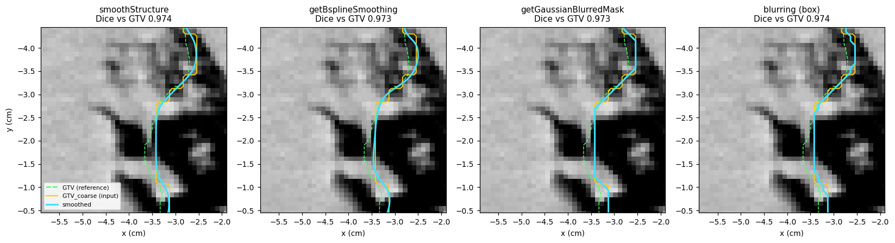
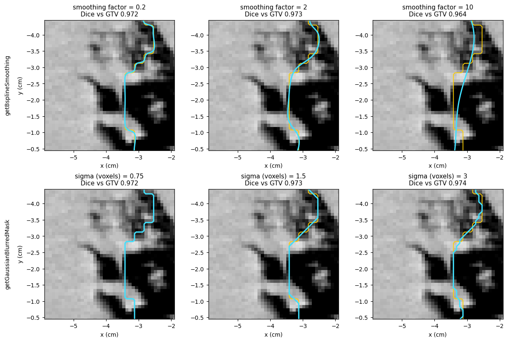
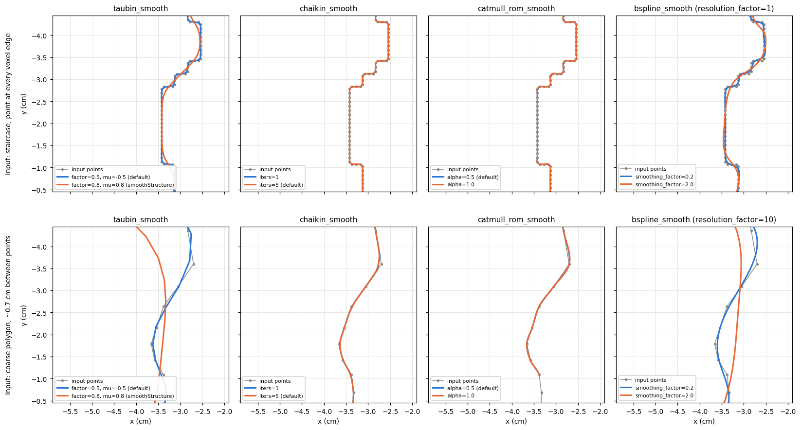

Smoothing contours and masks
============================

Segmentations made on a voxel grid have stair-stepped edges. This is most
visible when a model runs on a coarser grid than the scan and its mask is
mapped back, or when a mask is resampled from another scan. pyCERR can smooth
those edges in two ways:

* **Contour smoothing** moves the polygon vertices of each contour.
  :func:`~cerr.contour.contour_processing.smoothStructure` and
  :func:`~cerr.dataclasses.structure.getBsplineSmoothing` work on a whole
  structure; the functions in :mod:`cerr.contour.polyline_smoothing` work on a
  single contour.
* **Mask smoothing** blurs the binary mask and thresholds it at 0.5:
  :func:`~cerr.dataclasses.structure.getGaussianBlurredMask` and
  :func:`cerr.utils.mask.blurring`.

All of them work slice by slice, in the axial plane. None smooths across
slices.

Choosing a method
-----------------

.. list-table::
   :header-rows: 1
   :widths: 30 35 35

   * - Function
     - What it does
     - Use it when
   * - :func:`~cerr.contour.contour_processing.smoothStructure`
     - Finds the stair-stepped runs of each contour, smooths them with Taubin
       smoothing and joins them with Catmull-Rom splines. Other parts of the
       contour keep their shape.
     - A contour is mostly fine but has jagged stretches.
   * - :func:`~cerr.dataclasses.structure.getBsplineSmoothing`
     - Fits a closed smoothing B-spline to each contour and resamples it.
     - You want an evenly smooth outline with a single strength setting.
   * - :func:`~cerr.dataclasses.structure.getGaussianBlurredMask`
     - Gaussian-blurs the mask in each slice and thresholds it at 0.5.
     - You work with masks rather than contours, for example straight after
       AI inference.
   * - :func:`cerr.utils.mask.blurring` with ``filtType='box'``
     - The same with a box (mean) filter, on a mask array.
     - You need the blurred mask array itself.
   * - :mod:`cerr.contour.polyline_smoothing`
     - Taubin, Chaikin, Catmull-Rom and B-spline smoothing of one contour
       given as ``(x, y)`` points.
     - You process contour points yourself.

Prerequisites
-------------

The examples use the bundled lung CT phantom and its GTV. To get a jagged
input, the GTV mask is made 3 times coarser in-plane and mapped back with
nearest-neighbour interpolation, which gives 0.3 cm steps along the edge. The
original GTV is kept as the reference.

.. code-block:: python

   import os
   from cerr import datasets
   from cerr import plan_container as pc
   from cerr.contour import rasterseg as rs

   phantomDir = os.path.join(os.path.dirname(datasets.__file__),
                             'radiomics_phantom_dicom', 'pat_1')
   planC = pc.loadDcmDir(phantomDir)
   scanNum, gtvNum = 0, 0

   gtv3M = rs.getStrMask(gtvNum, planC)
   f = 3
   coarse3M = gtv3M[::f, ::f, :].repeat(f, axis=0).repeat(f, axis=1)
   coarse3M = coarse3M[:gtv3M.shape[0], :gtv3M.shape[1], :]
   planC = pc.importStructureMask(coarse3M, scanNum, 'GTV_coarse', planC)
   inNum = len(planC.structure) - 1

Smoothing a structure
---------------------

Each function adds a smoothed copy of ``GTV_coarse`` to ``planC``:

.. code-block:: python

   from cerr.contour.contour_processing import smoothStructure
   from cerr.dataclasses import structure as cerrStr
   from cerr.utils import mask as maskUtils

   # Taubin + Catmull-Rom on the jagged runs of each contour
   planC = smoothStructure(planC, inNum, replace_original=False,
                           name_suffix='_taubinCR')

   # Closed B-spline through each contour
   planC = cerrStr.getBsplineSmoothing(inNum, 1.0, 2.0, planC,
                                       replaceFlag=False,
                                       procSructName='GTV_bspline')

   # Gaussian blur of the mask, sigma in voxels
   blurred3M, planC = cerrStr.getGaussianBlurredMask(inNum, 1.5, planC,
                                                     saveFlag=True,
                                                     procSructName='GTV_gauss')

   # Box filter of radius 2 voxels on the mask array
   box3M = maskUtils.blurring(rs.getStrMask(inNum, planC), 2, filtType='box') >= 0.5
   planC = pc.importStructureMask(box3M, scanNum, 'GTV_box', planC)

   A 4 cm section of the GTV edge on its largest slice. Green dashed: the
   reference GTV. Yellow: the jagged input. Cyan: the result of each method.
   The contour methods (left two) give curves. The mask methods (right two)
   remove the 0.3 cm steps, but their contours still follow the voxel grid,
   because the result is a mask.

.. code-block:: text

   structure                vol (cc) Dice vs GTV perimeter (cm)
   GTV (reference)             358.7      1.000           32.4
   GTV_coarse (input)          358.1      0.972           36.1
   smoothStructure             357.3      0.974           30.6
   getBsplineSmoothing         357.6      0.973           30.7
   getGaussianBlurredMask      357.7      0.973           32.1
   blurring (box)              357.2      0.974           32.0

The perimeter is measured on the slice shown. All four methods change the
volume by less than 0.3 %, and Dice against the reference GTV by at most
0.002. Smoothing makes the outline more regular; it does not recover detail
that the coarse grid lost.

Smoothing strength
------------------

   Top: ``getBsplineSmoothing`` with smoothing factors 0.2, 2 and 10. Bottom:
   ``getGaussianBlurredMask`` with sigma 0.75, 1.5 and 3 voxels.

.. code-block:: text

   sweep                                     value vol (cc) Dice vs GTV
   getBsplineSmoothing, smoothing factor      0.20    357.9      0.972
   getBsplineSmoothing, smoothing factor      2.00    357.6      0.973
   getBsplineSmoothing, smoothing factor     10.00    356.8      0.964
   getGaussianBlurredMask, sigma (voxels)     0.75    358.1      0.972
   getGaussianBlurredMask, sigma (voxels)     1.50    357.7      0.973
   getGaussianBlurredMask, sigma (voxels)     3.00    356.1      0.974

**B-spline smoothing factor.** This is the ``s`` argument of
``scipy.interpolate.splprep``: the largest allowed sum of squared distances,
in cm², between the input points and the spline. With *n* points per contour
and a typical deviation of *d* cm, use ``s ≈ n·d²``. Here the contour on the
largest slice has 392 points, so ``s = 2`` allows about 0.07 cm, and ``s =
10`` about 0.16 cm, which starts to cut across real features (Dice drops to
0.964). The same factor is used for every contour of the structure, so short
contours, with fewer points, are smoothed relatively more.

**Gaussian sigma.** In voxels, in-plane. Use about half the step size you
want to remove: 1.5 voxels for the 3-voxel steps here. Larger values round
corners and shrink thin or convex parts.

Parameters
----------

:func:`~cerr.contour.contour_processing.smoothStructure`

.. list-table::
   :header-rows: 1
   :widths: 25 75

   * - Argument
     - Effect
   * - ``replace_original``
     - ``True`` (default) overwrites the structure. ``False`` appends a copy.
   * - ``name_suffix``
     - Added to the structure name of the result.
   * - ``tol``
     - Vertices flagged as jagged that are at most ``tol`` vertices apart
       are grouped into one jagged run (default 4).
   * - ``taubin_factor``, ``taubin_mu``
     - Weights of the two Taubin passes on jagged runs (both 0.8 by
       default). With a positive ``mu`` both passes pull points toward their
       neighbours, so the runs also shrink slightly; the Taubin default of
       ``mu = -0.5`` undoes most of that shrinkage.
   * - ``catmull_alpha``
     - Catmull-Rom parameterisation for the parts between jagged runs: 0
       uniform, 0.5 centripetal, 1 chordal (default).

A vertex is flagged as jagged when the path turns there by about 90° or
more, or continues almost straight; both are typical of voxel staircases. A contour
with no such vertex is left as it is, and ``No jagged segments`` is printed.

:func:`~cerr.dataclasses.structure.getBsplineSmoothing`

.. list-table::
   :header-rows: 1
   :widths: 25 75

   * - Argument
     - Effect
   * - ``resolutionFactor``
     - Number of output points relative to the input; 1.2 gives 20 % more.
   * - ``smootingFactor``
     - The ``splprep`` smoothing factor described above. 0 makes the spline
       pass through every point.
   * - ``replaceFlag``
     - ``True`` replaces the contours of the structure; otherwise a new
       structure is added.
   * - ``procSructName``
     - Name of the result. Defaults to the input name.

The argument names ``smootingFactor`` and ``procSructName`` are spelled as
shown. Contours with 3 or fewer points are copied unchanged. Repeated
consecutive points are dropped before fitting.

:func:`~cerr.dataclasses.structure.getGaussianBlurredMask`

.. list-table::
   :header-rows: 1
   :widths: 25 75

   * - Argument
     - Effect
   * - ``sigmaVoxel``
     - Gaussian sigma in voxels, applied in each axial slice.
   * - ``saveFlag``
     - ``True`` adds the thresholded result (blurred mask ≥ 0.5) to
       ``planC``. The function always returns the blurred, unthresholded
       mask.
   * - ``replaceFlag``
     - With ``saveFlag=True``, replaces the input structure instead of
       adding one.
   * - ``procSructName``
     - Name of the result. Defaults to the input name.

:func:`cerr.utils.mask.blurring` takes a mask array, ``sigmaVox`` and
``filtType`` (``'gaussian'`` or ``'box'``). For the box filter ``sigmaVox``
is the filter radius, an integer number of voxels. It returns the blurred
array; threshold it at 0.5 to get a mask.

Smoothing single contours
-------------------------

:mod:`cerr.contour.polyline_smoothing` smooths one contour given as an
``(N, 2)`` array of ``(x, y)`` points, such as ``seg.points[:, :2]`` from a
structure. Each function returns a new array of points.

.. code-block:: python

   import numpy as np
   from cerr.contour import polyline_smoothing as ps

   slc = 36
   seg = planC.structure[inNum].contour[slc].segments[0]
   P = seg.points[:, :2]

   # pick one of:
   xy = ps.taubin_smooth(P, factor=0.5, mu=-0.5, steps=5)
   xy = ps.chaikin_smooth(P, iters=5)
   xy = ps.catmull_rom_smooth(P, alpha=0.5, subdivs=10)
   xy = ps.bspline_smooth(P, resolution_factor=1.0, smoothing_factor=2.0)

   # put the result back, with the slice's z
   seg.points = np.column_stack((xy, np.full(len(xy), seg.points[0, 2])))

After changing ``seg.points`` directly, regenerate the raster segments with
``planC.structure[inNum].rasterSegments = rs.generateRastersegs(planC.structure[inNum], planC)``
so that masks reflect the change.

   Top: the jagged contour, with a point at every voxel edge. Bottom: a
   coarse polygon with about 0.7 cm between points, like one clicked by
   hand.

The figure shows what each function is for:

* **Taubin** and **B-spline** smoothing move points to remove noise, and
  work on dense staircases. On a coarse polygon, Taubin with ``mu = 0.8``
  shrinks the outline noticeably.
* **Chaikin** and **Catmull-Rom** add points to round corners. They leave a
  dense staircase almost unchanged, because every point already lies on a
  straight run, but they turn a coarse polygon into a smooth curve.
  Catmull-Rom passes through the input points; Chaikin cuts the corners.
  Each adds many points: Chaikin with ``iters=5`` gives 32 output points per
  input point, Catmull-Rom with ``subdivs=10`` gives 10.

.. list-table::
   :header-rows: 1
   :widths: 24 38 38

   * - Function
     - Arguments
     - Output
   * - ``taubin_smooth``
     - ``factor`` (default 0.5), ``mu`` (-0.5), ``steps`` (5)
     - Same number of points
   * - ``chaikin_smooth``
     - ``iters`` (5), ``keep_ends`` (True)
     - About 2\ :sup:`iters` points per input point
   * - ``catmull_rom_smooth``
     - ``alpha`` (0.5), ``subdivs`` (10)
     - ``subdivs`` points per input point
   * - ``bspline_smooth``
     - ``resolution_factor`` (1.0), ``smoothing_factor`` (0.1)
     - ``resolution_factor`` × input points

A contour whose last point equals its first is treated as closed by Taubin,
Chaikin and Catmull-Rom; otherwise its end points stay fixed. ``bspline_smooth``
always fits a closed curve. Taubin, Chaikin and Catmull-Rom replace the
functions of the same name in the ``shapelysmooth`` package, which pyCERR no
longer needs.

Where smoothing fits in post-processing
---------------------------------------

The post-processing scripts of the bundled AI models
(``cerr/ai_models/post``) map the model output back to the original scan, keep
the largest connected components and fill holes. They do not smooth. To add
smoothing, run it last, after islands are removed and holes filled, so that it
does not round off fragments that are about to be removed:

.. code-block:: python

   _, planC = cerrStr.getLargestConnComps(aiNum, 1, planC, saveFlag=True,
                                          replaceFlag=True)
   _, planC = cerrStr.getGaussianBlurredMask(aiNum, 1.0, planC, saveFlag=True,
                                             replaceFlag=True)

See :doc:`ai_inference` for the full sequence of steps.

To smooth an image rather than a structure, see the mean filter in
:doc:`texture`.

See also
--------

* :doc:`segmentation` for other structure operations (margins, Boolean
  operations, closing, connected components).
* API reference: :doc:`../cerr.contour`, :doc:`../cerr.dataclasses`,
  :doc:`../cerr.utils`.
* Figure script: ``docs/_figure_scripts/smoothing.py``.
