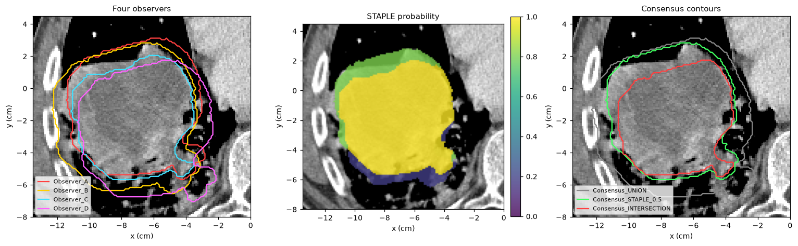
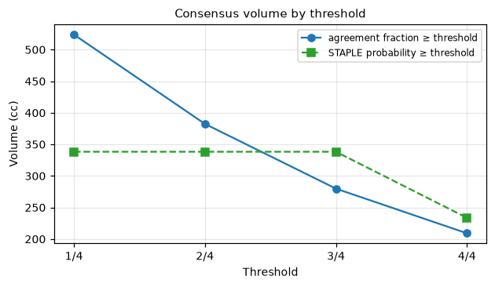

Consensus contours
==================

When several people, or several auto-segmentation models, contour the same
structure, their contours differ. :mod:`cerr.contour.structure_consensus`
measures how much they agree and combines them into a single consensus
contour. It is the pyCERR counterpart of CERR's ``structCompare``.

Given *N* contours of one target on one scan, it computes:

* the fraction of observers that included each voxel;
* a STAPLE consensus (Warfield et al., IEEE TMI 2004): a probability map of
  the true contour, together with each observer's estimated sensitivity and
  specificity;
* Fleiss' kappa for inter-observer agreement;
* union, intersection and consensus volumes at a range of thresholds.

Prerequisites
-------------

A ``planC`` with two or more structures of the same target on the same scan,
for example one RTSTRUCT per observer. The examples use the bundled lung
phantom. It has a single GTV, so four "observers" are derived from it: copies
shifted by a few millimetres and drawn 3 mm larger or smaller, and an outlier
shifted by about 1.4 cm (see ``docs/_figure_scripts/structure_consensus.py``).

Minimal example
---------------

.. code-block:: python

   from cerr.contour import structure_consensus as sc

   observerNums = [0, 1, 2, 3]                     # indices in planC.structure
   result = sc.compareStructures(observerNums, planC)
   print(sc.summaryText(result))

   planC, consensusNum = sc.createConsensusStructure(observerNums, planC,
                                                     method='staple', threshold=0.5,
                                                     result=result)

Walkthrough
-----------

Compare the observers
~~~~~~~~~~~~~~~~~~~~~

:func:`~cerr.contour.structure_consensus.compareStructures` does the work and
returns a dictionary. :func:`~cerr.contour.structure_consensus.summaryText`
formats the main numbers:

.. code-block:: text

   Structure consensus comparison
   ==================================
   Observers (4):
       Observer_A                     358.681 cc
       Observer_B                     444.414 cc
       Observer_C                     233.683 cc
       Observer_D                     358.681 cc

   Observer volume  min/max/mean/std (cc): 233.683 / 444.414 / 348.865 / 75.149
   Union volume (>=1 observer):          523.913 cc
   Intersection volume (all observers):  209.179 cc
   Fleiss' kappa:                         0.6257
   STAPLE sensitivity  mean/std: 0.8656 / 0.1220
   STAPLE specificity  mean/std: 0.9164 / 0.0613

   Volume vs. agreement threshold:
     threshold      agreement(cc)  STAPLE(cc)
     0.250          523.913        338.347
     0.500          382.449        338.347
     0.750          279.918        338.347
     1.000          209.179        233.683

STAPLE also rates each observer against its estimate of the true contour.
The smallest contour (C) misses the most of it, and the outlier (D) both
misses part of it and includes tissue outside it:

.. code-block:: python

   for name, se, sp in zip(result['structNames'], result['sensitivity'],
                           result['specificity']):
       print('%-11s sensitivity %.3f  specificity %.4f' % (name, se, sp))

.. code-block:: text

   Observer_A  sensitivity 0.964  specificity 0.9483
   Observer_B  sensitivity 1.000  specificity 0.8457
   Observer_C  sensitivity 0.700  specificity 1.0000
   Observer_D  sensitivity 0.799  specificity 0.8715

Main fields of ``result``:

.. list-table::
   :header-rows: 1
   :widths: 32 68

   * - Key
     - Content
   * - ``agreementFraction3M``
     - Fraction of observers including each voxel, on the full scan grid.
   * - ``staple3M``
     - STAPLE probability map (``None`` if ``runStaple=False``).
   * - ``sensitivity``, ``specificity``
     - Per-observer STAPLE estimates, in the order of ``structNames``.
   * - ``kappa``
     - Fleiss' kappa, over the bounding box of the union.
   * - ``reliability3M``
     - Chance-corrected per-voxel reliability.
   * - ``observerVolumes_cc``, ``volumeStats``
     - Each observer's volume, and their min, max, mean and SD.
   * - ``volumeByAgreement_cc``, ``stapleVolumeByThreshold_cc``
     - Consensus volume at thresholds *k/N*, *k* = 1 … *N*.
   * - ``union_cc``, ``intersection_cc``, ``voxelVolume_cc``
     - Volumes in cc.

STAPLE is the slowest part. Pass ``runStaple=False`` when only agreement
fractions and kappa are needed.

Make consensus contours
~~~~~~~~~~~~~~~~~~~~~~~

:func:`~cerr.contour.structure_consensus.createConsensusStructure` turns the
result into a structure in ``planC``. Pass the ``result`` you already have so
the comparison is not repeated.

.. code-block:: python

   for method, threshold in (('staple', 0.5), ('majority', None), ('agreement', 0.75),
                             ('union', None), ('intersection', None)):
       kw = {} if threshold is None else {'threshold': threshold}
       planC, newNum = sc.createConsensusStructure(observerNums, planC, method=method,
                                                   result=result, **kw)

.. code-block:: text

   staple       -> 4 Consensus_STAPLE_0.5       338.3 cc
   majority     -> 5 Consensus_MAJORITY         279.9 cc
   agreement    -> 6 Consensus_AGREEMENT_0.75   279.9 cc
   union        -> 7 Consensus_UNION            523.9 cc
   intersection -> 8 Consensus_INTERSECTION     209.2 cc

.. list-table::
   :header-rows: 1
   :widths: 18 82

   * - Method
     - Voxels included
   * - ``staple``
     - STAPLE probability ≥ ``threshold``.
   * - ``majority``
     - Included by more than half of the observers. With four observers
       that means at least three, the same as ``agreement`` at 0.75.
   * - ``agreement``
     - Agreement fraction ≥ ``threshold``.
   * - ``union``
     - Included by at least one observer.
   * - ``intersection``
     - Included by every observer.

Pass ``structName`` to name the new structure, or ``importResult=False`` to
get the mask back without adding it to ``planC``.

   Left: the four observer contours. Centre: the STAPLE probability. Right:
   union, STAPLE at 0.5 and intersection.

   The agreement-based volume shrinks steadily as more observers must agree.
   The STAPLE volume barely changes, because STAPLE probabilities cluster near
   0 and 1.

Interactive use
---------------

The desktop viewer (``pycerr[viewer]``) has the same tool under
*Tools > Structure consensus (compare/STAPLE)*, which shows the report and
adds the consensus structures to the plan. A command-line example is in
``cerr/scripts/structure_consensus_example.py``; from a source checkout:

.. code-block:: bash

   python cerr/scripts/structure_consensus_example.py /path/to/dicom 0 1 2

See also
--------

* :doc:`segmentation_metrics` to score each observer against the consensus
  with Dice and Hausdorff distance.
* API reference: :doc:`../cerr.contour`.
* Figure script: ``docs/_figure_scripts/structure_consensus.py``.
