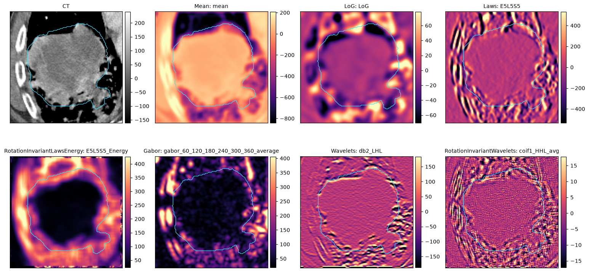

Texture filters
===============

A texture filter turns a scan into a response map: a new image whose value at
each voxel describes the local texture, such as edges, blobs, ripples or a
particular frequency band. Response maps can be viewed, exported, and used to
compute radiomics features. pyCERR implements the filters of IBSI chapter 2
(Image Biomarker Standardisation Initiative) and is tested against its
reference responses.

For scalar features computed from the original image, see :doc:`radiomics`.

Prerequisites
-------------

A ``planC`` with a scan and, for most uses, a structure that defines the
region of interest. The examples use the bundled lung phantom and its GTV.

Minimal example
---------------

.. code-block:: python

   import os
   from cerr import datasets
   from cerr.radiomics import texture_utils

   filterFile = os.path.join(os.path.dirname(datasets.__file__),
                             'convolutional_filter_settings', 'LoG_filter.json')
   planC = texture_utils.generateTextureMapFromPlanC(planC, scanNum, structNum, filterFile)
   texScanNum = len(planC.scan) - 1

The response map is added to ``planC.scan``, cropped to the structure plus
the margin given in the settings file.

Filters
-------

   The phantom CT around the GTV (cyan) and seven filter responses, computed
   with the parameters listed below.

Each filter is named in the ``imageType`` section of a settings file, with
its parameters. The table gives the parameters used for the figure.

.. list-table::
   :header-rows: 1
   :widths: 26 40 34

   * - ``imageType``
     - Parameters (figure values)
     - Responds to
   * - ``Mean``
     - ``"KernelSize": [5, 5, 5]``
     - Local average; a smoothed image.
   * - ``Sobel``
     - none
     - In-plane gradient, slice by slice. Returns two maps, ``SobelMag``
       (magnitude) and ``SobelDir`` (direction, radians). Not part of IBSI-2.
   * - ``LoG``
     - ``"Sigma_mm": [3, 3, 3], "CutOff_mm": [12, 12, 12]``
     - Blobs and edges at the scale ``Sigma_mm`` (Laplacian of Gaussian).
       ``CutOff_mm`` sets the kernel extent, usually 4 σ.
   * - ``Laws``
     - ``"Direction": "3d", "Type": "E5L5S5", "Normalize": "yes"``
     - Laws' kernels: one 1D kernel per axis, chosen from L (level), E (edge),
       S (spot), W (wave) and R (ripple), of length 3 or 5.
   * - ``LawsEnergy``, ``RotationInvariantLawsEnergy``
     - Laws parameters plus ``"EnergyKernelSize": [7, 7, 7]``,
       ``"EnergyPadMethod"``, ``"EnergyPadSize"``
     - Local energy (mean absolute response) of a Laws filter.
   * - ``Gabor``, ``Gabor3d``
     - ``"Sigma_mm": 2.1, "Wavlength_mm": 1.4, "SpatialAspectRatio": 1.5,
       "Orientation": [60, ..., 360], "OrientationAggregation": "average"``
     - Periodic patterns of a given wavelength and orientation in-plane;
       ``Gabor3d`` also filters in the sagittal and coronal planes.
   * - ``Wavelets``
     - ``"Wavelets": "db", "Index": "2", "Direction": "LHL", "Level": 1``
     - One sub-band of an undecimated wavelet transform: low (L) or high (H)
       pass along each axis. ``"Level"`` sets the decomposition level; each
       level doubles the scale.
   * - ``RotationInvariant…``
     - The base filter's parameters plus
       ``"RotationInvariance": {"Dim": "3D", "AggregationMethod": "max"}``
     - The response pooled over 24 rotations (``"Dim": "3D"``) or 4 in-plane
       rotations (``"2D"``), with ``max`` or ``avg``. Available for Laws,
       Laws energy and wavelets.

.. note::

   ``Wavlength_mm`` is spelled as shown in settings files.

Padding
~~~~~~~

Filters need values beyond the edge of the region. The ``settings.padding``
block sets how the scan is extended before filtering and how far:

.. code-block:: json

   "settings": {"padding": {"method": "mirror", "size": [6, 6, 6]}}

``method`` is ``padzeros``, ``nearest``, ``periodic``, ``mirror`` or
``expand`` (use real neighbouring voxels where the scan has them). Without a
``padding`` block, ``cropToMask`` crops to the structure plus a margin, as in
the sample files.

Settings files to start from
~~~~~~~~~~~~~~~~~~~~~~~~~~~~

* ``cerr/datasets/convolutional_filter_settings``: mean, LoG, rotation-invariant
  Laws energy and Gabor examples.
* ``cerr/datasets/radiomics_settings/ibsi_settings/ibsi2_phase_1``: one file
  per IBSI-2 test case, covering every filter, padding method and 2D/3D
  variant. These are the configurations pyCERR is validated with.

Filtering arrays directly
-------------------------

To filter a NumPy array without a ``planC``, call
:func:`~cerr.radiomics.texture_utils.processImage` with the filter name and
a parameter dictionary. Filters defined in millimetres need the voxel size:

.. code-block:: python

   import numpy as np
   from cerr.contour import rasterseg as rs
   from cerr.radiomics import texture_utils

   scan3M = planC.scan[scanNum].getScanArray().astype(float)
   mask3M = rs.getStrMask(structNum, planC)
   voxelSizeMm = planC.scan[scanNum].getScanSpacing() * 10      # cm -> mm

   paramS = {'Sigma_mm': [3, 3, 3], 'CutOff_mm': [12, 12, 12],
             'VoxelSize_mm': voxelSizeMm}
   outS = texture_utils.processImage('LoG', scan3M, mask3M, paramS)
   log3M = outS['LoG']

``processImage`` returns a dictionary because some filters produce several
maps. The keys for the figure were ``mean``, ``LoG``, ``E5L5S5``,
``E5L5S5_Energy``, ``gabor_60_120_180_240_300_360_average``, ``db2_LHL`` and
``coif1_HHL_avg``. :func:`~cerr.radiomics.texture_utils.loadSettingsFromFile`
reads a settings file into the same parameter dictionaries and adds the
voxel size from a scan.

The lower-level filters are in :mod:`cerr.radiomics.texture_filters`, for
example :func:`~cerr.radiomics.texture_filters.LoGFilter` and
:func:`~cerr.radiomics.texture_filters.getLawsMasks`.

Features from filtered images
-----------------------------

Adding a filter to ``imageType`` in a radiomics settings file computes the
requested features from the response map inside the structure (IBSI-2 phase
2):

.. code-block:: json

   {
     "imageType": {"LoG": {"Sigma_mm": [3, 3, 3], "CutOff_mm": [12, 12, 12]}},
     "settings": {"padding": {"method": "mirror", "size": [6, 6, 6]},
                  "firstOrder": {"offsetForEnergy": 0}},
     "featureClass": {"firstOrder": {"featureList": ["all"]}}
   }

.. code-block:: python

   from cerr.radiomics import ibsi1

   featDict, diagDict = ibsi1.computeScalarFeatures(scanNum, structNum,
                                                    'log_features.json', planC)

.. code-block:: text

   log_sigma_333mm_cutoff_121212mm_firstOrder_mean      -4.450
   log_sigma_333mm_cutoff_121212mm_firstOrder_std       36.877
   log_sigma_333mm_cutoff_121212mm_firstOrder_skewness   0.226
   log_sigma_333mm_cutoff_121212mm_firstOrder_kurtosis   3.332

The key prefix records the filter and its parameters, so features from
several filters and the original image can sit in one table. List
``"Original": {}`` alongside the filters to get both. The phase-2 files in
``ibsi_settings/ibsi2_phase_2`` are complete examples.

Viewing response maps
---------------------

A response map from :func:`~cerr.radiomics.texture_utils.generateTextureMapFromPlanC`
is a scan like any other, so all viewers show it. To see the structure on it,
copy the structure to the new scan:

.. code-block:: python

   from cerr.dataclasses import structure as cerrStr
   from cerr.viewer import pycerr_nbviewer

   planC = cerrStr.copyToScan(structNum, texScanNum, planC)
   pycerr_nbviewer.showNB(planC, scan_nums=[texScanNum],
                          struct_nums=[len(planC.structure) - 1])

See also
--------

* IBSI-2 reference manual: https://theibsi.github.io/ibsi2/
* Tests against IBSI-2 reference values: ``tests/test_ibsi2_filters.py`` and
  ``tests/test_ibsi2_features.py``.
* Notebook: ``06_radiomics_extraction/analyzing_image_texture_using_pycerr.ipynb``
  in https://github.com/cerr/pyCERR-Notebooks.
* API reference: :doc:`../cerr.radiomics`.
* Figure script: ``docs/_figure_scripts/texture.py``.
